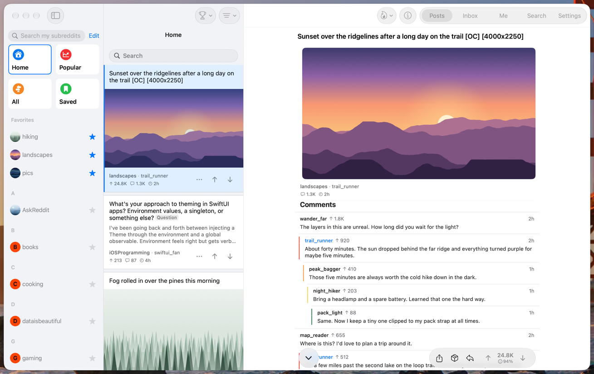
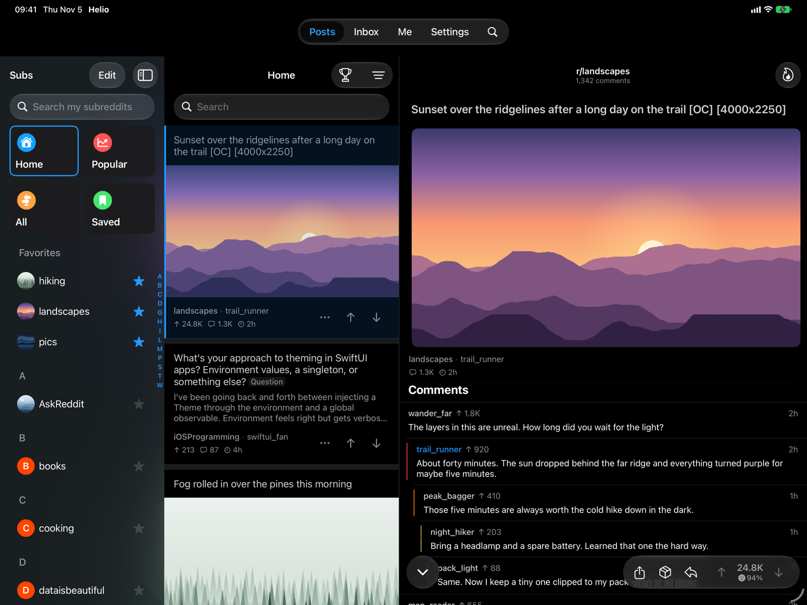
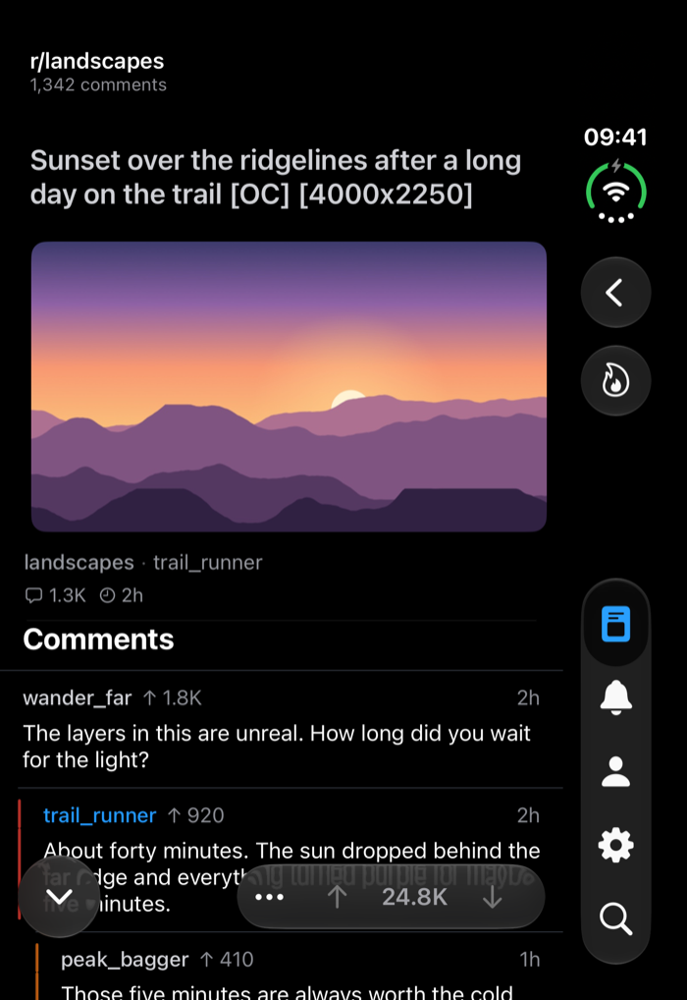
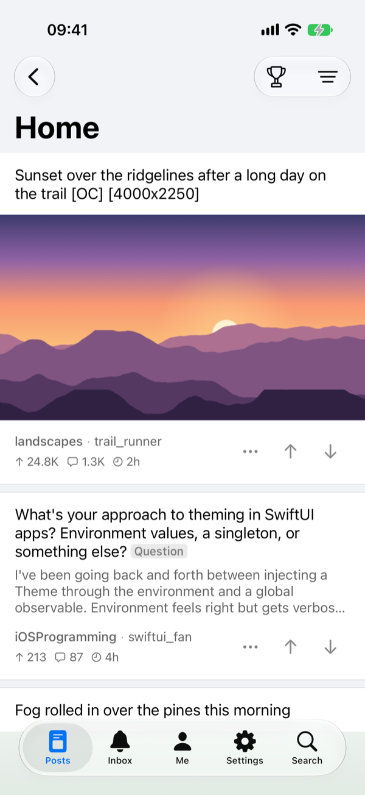

# Helio

**A privacy-focused Reddit client for iPhone, iPad and Mac.**

No analytics, no tracking, no ads. Your account talks only to Reddit.

  

[Install](#install) · [Report a bug](https://github.com/sozercan/helio/issues) · [Contributing](CONTRIBUTING.md)

 

<table>
  <tr>
    <td colspan="3" align="center">
      
       <b>Mac</b>
    </td>
  </tr>
  <tr>
    <td align="center" width="41%">
      
       <b>iPad</b>
    </td>
    <td align="center" width="44%">
      
       <b>iPhone Duo</b>, unfolded
    </td>
    <td align="center" width="15%">
      
       <b>iPhone</b>
    </td>
  </tr>
</table>

## Privacy

Privacy is the point of Helio, not a setting.

- **No analytics or tracking.** No telemetry and no usage data.
- **No ads.** No advertising SDKs of any kind.
- **No third parties.** No third-party SDKs, services or app backend.
- **Only Reddit sees your account.** Sign-in and every account request go to Reddit's own endpoints. Images, videos and link previews load from the sites that host them, as they would in a browser.
- **Open source.** Read the code to check all of the above.

## Install

Helio runs on iOS 26, iPadOS 26 and macOS 26 or later. Sign in with your Reddit account inside the app; no API key is needed.

### Sideload a release

Each [release](https://github.com/sozercan/helio/releases) has an unsigned `.ipa` and a Mac `.zip`.

- **iPhone and iPad:** add the source `https://sozercan.github.io/helio/source.json` in [SideStore](https://sidestore.io) or [AltStore](https://altstore.io) to install and get updates, or sideload the `.ipa` with [Sideloadly](https://sideloadly.io). These tools re-sign the app with your Apple ID. With a free account the app has to be refreshed every 7 days, and the Safari extension uses a second app ID. iCloud isn't available to sideloaded apps, so data stays on the device.
- **Mac:** unzip, move Helio to Applications, then allow it under System Settings › Privacy & Security on first launch. The build isn't notarized and has no keychain access, so it asks you to sign in to Reddit again on each launch. Build it yourself to keep the login. After the first install, Helio › Check for Updates… installs new versions.

### Build it yourself

1. Clone the repo and open `App/Helio.xcodeproj` in Xcode.
2. Set your development team and bundle identifier in the project settings.
3. Build and run on your device.

<b>Using your own Reddit API key</b>

 

If you'd rather use an API key you created on Reddit, choose "Use my own API key" when you sign in. Your Reddit app's redirect URI must be `https://sozercan.github.io/helio/auth-success`: Reddit only accepts https redirects for web apps, and that page (served from this repo's `gh-pages` branch) forwards to the app. If your app was created with another redirect URI, change it under "edit" at https://www.reddit.com/prefs/apps.

## Credits

Helio builds on the [Winston](https://github.com/lo-cafe/winston) app and its community, and its design is inspired by Apollo and Alien Blue.

## License

Helio is free and open source software, licensed under the [GPL-3.0](LICENSE.md).
